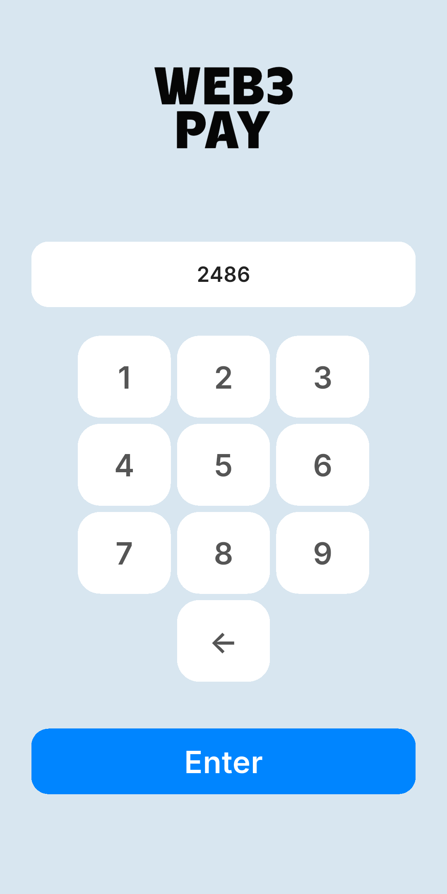
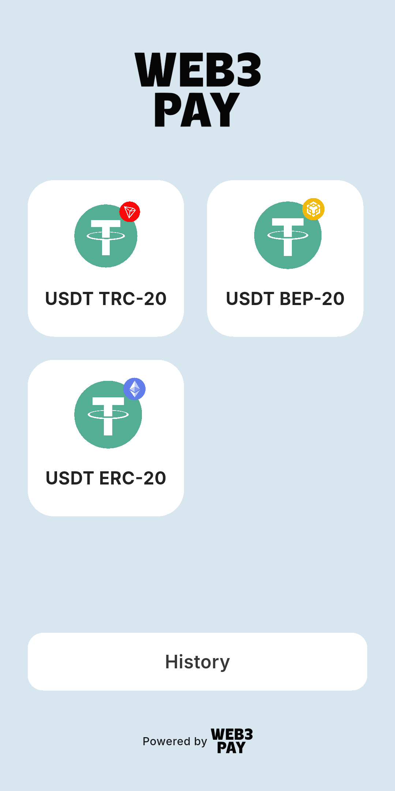
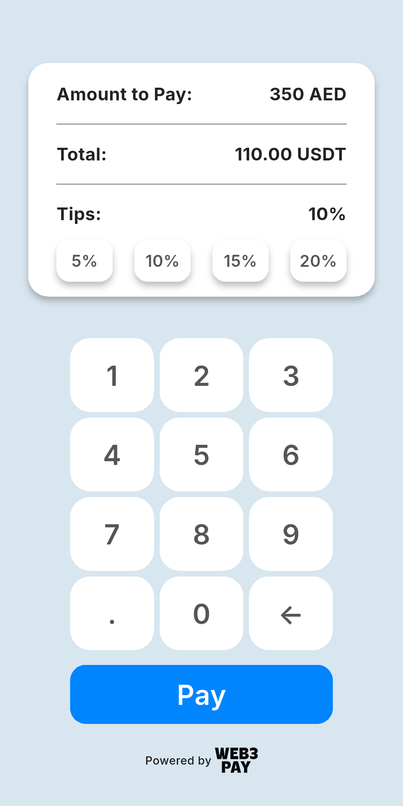
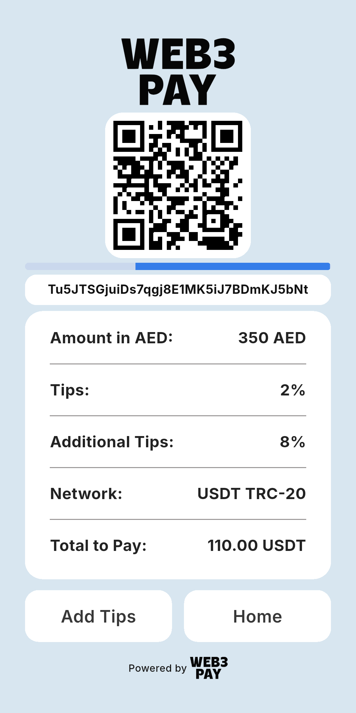
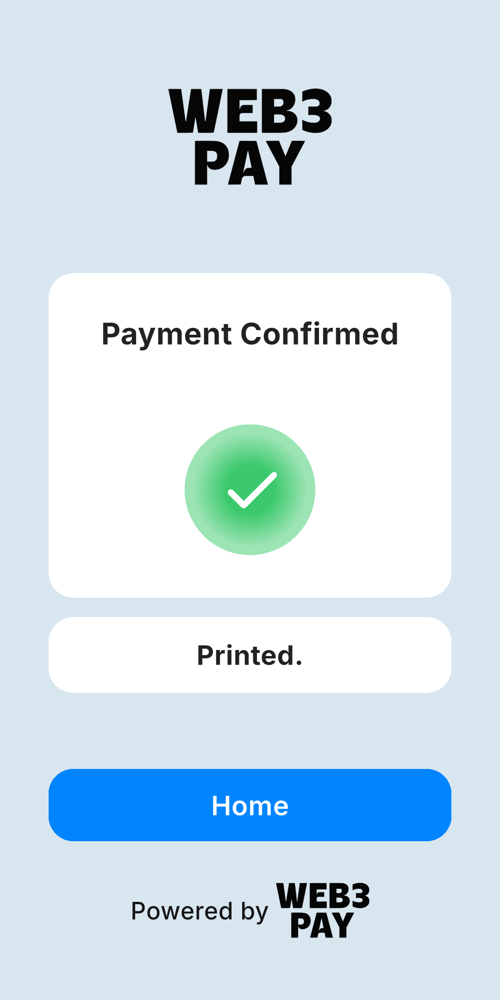
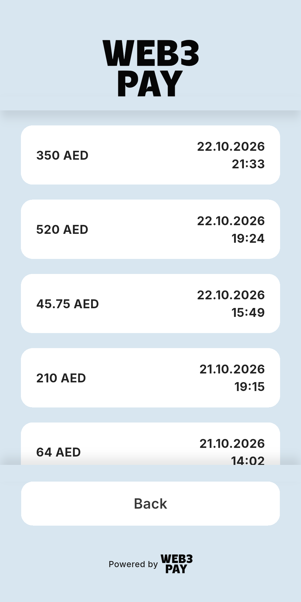

# Web3 Pay Terminal

Flutter app for Sunmi Android POS terminals that accepts USDT payments.
The cashier enters an amount in AED, the customer picks a network and tip,
scans the QR code and pays. The terminal watches the blockchain, confirms
the payment and prints a receipt on the built-in Sunmi printer.

- Networks: USDT TRC-20 (Tronscan), BEP-20 and ERC-20 (Etherscan API V2)
- Terminal settings and payment history are stored in Firebase Realtime Database
- Receipt printing via `sunmi_printer_plus`
- Fullscreen kiosk UI designed for 720×1440 terminal screens

| Terminal login | Network | Amount and tips |
| --- | --- | --- |
|  |  |  |

| Waiting for payment | Payment confirmed | History |
| --- | --- | --- |
|  |  |  |

## Running

```sh
flutter pub get
flutter run
```

The demo mode works without Firebase, blockchain explorers and a Sunmi printer:
any terminal id opens a demo terminal, payments are confirmed after a few seconds.

```sh
flutter run --dart-define=DEMO=true
```
